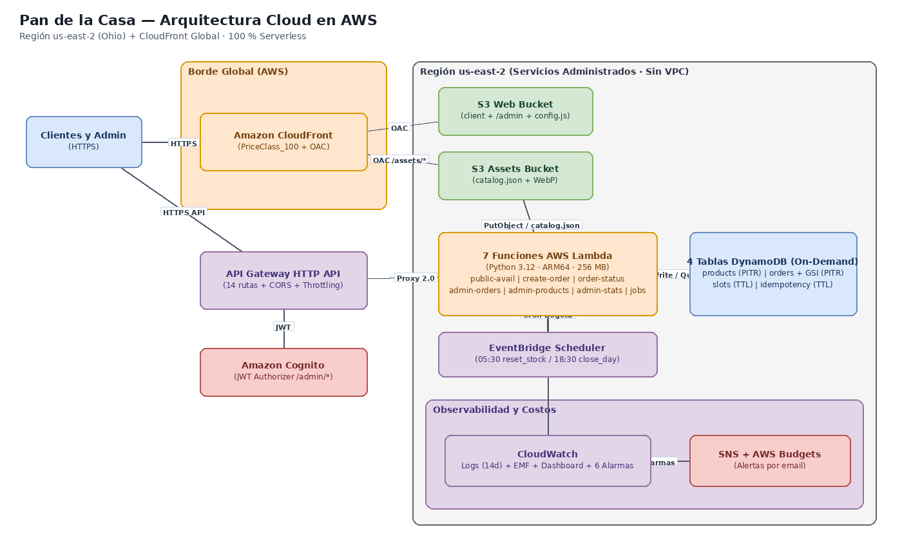

# Pan de la Casa

Plataforma web **serverless en AWS** para la panadería "Pan de la Casa" (Bogotá): catálogo con fotos, pedidos para **recoger en tienda en franjas de 30 minutos** (máximo 10 pedidos por franja), seguimiento del estado del pedido y panel de administración. Se paga en la tienda al recoger.

Proyecto final del curso PENU — Escuela Colombiana de Ingeniería Julio Garavito.



## Ambientes

| Ambiente | Sitio del cliente | Panel admin | API |
|---|---|---|---|
| `dev` | _PENDIENTE (Juan Pablo)_ | _PENDIENTE_ `/admin/index.html` | _PENDIENTE_ |
| `prod` | _PENDIENTE (Juan Pablo)_ | _PENDIENTE_ `/admin/index.html` | _PENDIENTE_ |

`dev` se despliega solo con cada merge a `develop`; `prod` se despliega con cada merge a `main`, después de una **aprobación manual**.

## Arquitectura en una tabla

| Capa | Servicio |
|---|---|
| Presentación | CloudFront + S3 (sitio del cliente en la raíz, panel en `/admin/`, imágenes y `catalog.json`) |
| API | API Gateway HTTP API + JWT de Cognito en `/api/admin/*` |
| Cómputo | 7 funciones Lambda (Python 3.12, ARM64) |
| Datos | DynamoDB on-demand (`products`, `orders`, `slots`, `idempotency`) + S3 |
| Identidad | Cognito (Hosted UI + PKCE) e IAM (un rol por Lambda) |
| Jobs | EventBridge Scheduler (05:30 reinicio de stock, 18:30 cierre del día) |
| Operación | CloudWatch (logs JSON, métricas EMF, dashboard, alarmas) + SNS + Budgets |
| Entrega | Terraform + GitHub Actions con OIDC |

El porqué de cada decisión está en el [HLD](docs/hld/) y en los [ADR](docs/adr/).

## Estructura del repositorio y dueños

```
backend/              Juan        Lambdas en Python, dominio, tests (pytest + moto) y datos semilla
  src/app/            → paquete que se despliega (solo stdlib + boto3)
  tests/              → unit/ (dominio sin AWS) e integration/ (handlers + moto)
  seed/, scripts/     → productos iniciales y script de carga
frontend/             Juan        HTML + CSS + JS (módulos ES), sin build ni frameworks
  client/             → sitio del cliente (raíz del bucket web)
  admin/              → panel de administración (prefijo admin/)
  dev_server.py       → servidor local que imita el despliegue
infra/                Juan Pablo  Terraform (bootstrap, módulo app, envs dev y prod)
.github/workflows/    Juan Pablo  CI/CD
scripts/              Juan Pablo  smoke test y generación de config.js
docs/
  hld/                Juan        HLD por secciones (04–06 de Juan Pablo) + build_hld.sh
  adr/                Ambos       ADR-001–004 (Juan), ADR-005–007 (Juan Pablo)
  diagrams/, costs/, deployment/  Juan Pablo
```

## Desarrollo local (sin AWS)

Requisitos: Python 3.12. No se necesita una cuenta de AWS: el backend se prueba con **moto** (DynamoDB y S3 simulados) y los frontends funcionan con **datos simulados**.

### Backend

```bash
cd backend
python3.12 -m venv .venv && source .venv/bin/activate
python -m pip install -r requirements-dev.txt
ruff check .
ruff format --check .
pytest          # incluye cobertura; falla si baja del 70 %
```

Son los mismos comandos que corre el pipeline.

### Frontends

```bash
cd frontend
python3 dev_server.py
```

- Cliente: <http://localhost:5500/>
- Panel admin: <http://localhost:5500/admin/index.html> (botón **"Entrar (mock)"**)

Sin `client/config.js`, el servidor usa `client/config.example.js` (`useMock: true`). En modo mock:

- El catálogo, los cupos y los pedidos son simulados y se guardan en `localStorage`.
- Fuera del horario de la tienda, el mock simula las 8:00 a. m. para poder probar a cualquier hora.
- Un pedido avanza solo a "En preparación" a los 40 s y a "Listo para recoger" a los 80 s (para ver el polling).

Para probar **contra dev**, copia la configuración de ejemplo y edítala con `useMock: false` y las URLs de dev (`config.js` está en `.gitignore`):

```bash
cp frontend/client/config.example.js frontend/client/config.js
```

## Despliegue

Todo cambio entra por una rama `feature/<cambio>` → PR a `develop` (despliega `dev`) → PR `develop` → `main` (despliega `prod` con aprobación). El pipeline, los ambientes, el rollback y el runbook están en [`docs/deployment/`](docs/deployment/) (Juan Pablo).

Datos semilla (los ejecuta Juan Pablo, una vez por ambiente; ver el docstring del script):

```bash
cd backend && python scripts/seed_products.py --table pdc-dev-products --region us-east-1 --dry-run
```

## Documentación

| Documento | Dónde |
|---|---|
| HLD (documento principal) | [`docs/hld/`](docs/hld/) — se arma con `bash docs/hld/build_hld.sh` |
| Decisiones de arquitectura | [`docs/adr/`](docs/adr/) |
| Diagramas | [`docs/diagrams/`](docs/diagrams/) |
| Costos | [`docs/costs/`](docs/costs/) |
| Despliegue y operación | [`docs/deployment/`](docs/deployment/) |

## Integrantes

| Integrante | Rol |
|---|---|
| **Juan** | Aplicación: backend (Lambdas, dominio, tests), frontends (cliente y admin), HLD y ADR-001 a 004 |
| **Juan Pablo** | Plataforma: cuenta AWS, Terraform, CI/CD, observabilidad, costos, diagramas y ADR-005 a 007 |
