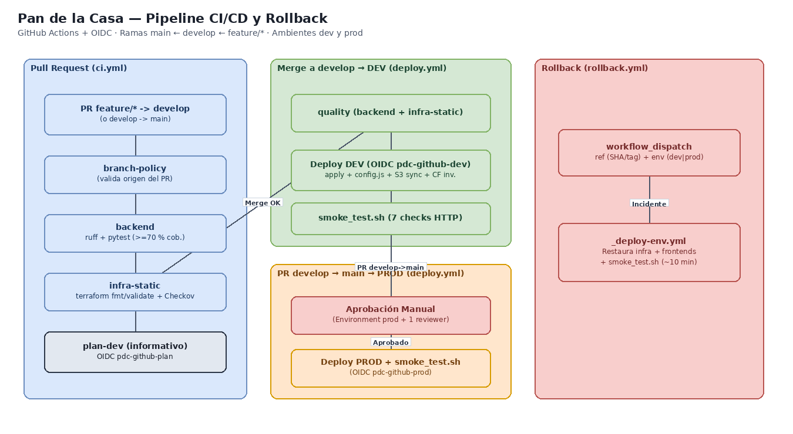

# Diseño de despliegue y operación — Pan de la Casa

> Documento técnico de despliegue, CI/CD, ambientes, secretos, rollback y runbook operativo.

---

## 1. Etapas del pipeline CI/CD (GitHub Actions)



*Figura 1. Pipeline de integración y despliegue continuo con OIDC y promoción `dev` → `prod`.*

| Etapa / Job | Workflow | Herramientas | Qué valida | ¿Bloquea? | Duración aprox. |
|---|---|---|---|---|---|
| `branch-policy` | `ci.yml` (solo PR) | Bash en runner | `main` solo recibe PR desde `develop`; `develop` solo desde `feature/*` | **Sí** | ~5 s |
| `backend` | `ci.yml` | Python 3.12, `ruff`, `pytest` | Lint, formato, pruebas unitarias y de integración (`moto`) con cobertura ≥ 70 % | **Sí** | ~30 s |
| `infra-static` | `ci.yml` | Terraform 1.10, `checkov` | `terraform fmt -check`, `validate` (`dev` y `prod`) y escaneo de seguridad estático (`.checkov.yaml`) | **Sí** | ~45 s |
| `plan-dev` | `ci.yml` (solo PR) | Terraform + OIDC (`pdc-github-plan`) | `terraform plan -lock=false` sobre `dev` publicado en `$GITHUB_STEP_SUMMARY` | No (informativo) | ~25 s |
| `deploy` (`dev` / `prod`) | `_deploy-env.yml` | Terraform, AWS CLI, `jq` | `terraform apply`, generación de `/config.js`, `aws s3 sync` de frontends e invalidación de CloudFront (`/*`) | **Sí** | ~3–10 min |
| `smoke_test` | `_deploy-env.yml` | `curl`, `jq` (`scripts/smoke_test.sh`) | 7 verificaciones HTTP/HTTPS post-deploy (home, `config.js`, `/api/health`, 22 franjas en `/api/availability`, 401 sin JWT en admin, HSTS) | **Sí** | ~15 s–2 min |

---

## 2. Ambientes y estrategia de promoción

- **Paridad de infraestructura:** `infra/envs/dev` y `infra/envs/prod` invocan el mismo módulo [`infra/modules/app`](../../infra/modules/app), variando únicamente `env`, orígenes CORS locales (`http://localhost:5500` solo en `dev`) y callbacks de Cognito.
- **Estado aislado:** ambos ambientes comparten el bucket `pdc-tfstate-<accountId>` (región `us-east-2`, `use_lockfile = true`), pero en claves separadas: `app/dev/terraform.tfstate` y `app/prod/terraform.tfstate`. Los roles OIDC tienen un `Deny` explícito sobre el state del otro ambiente.
- **Promoción (*build once, promote*):** el código y la infraestructura se validan e integran primero en `develop` (despliegue automático a `dev` + smoke test). Cuando `dev` es estable, se abre un PR `develop` → `main` que exige revisión del compañero y aprobación manual en el GitHub Environment `prod` antes de aplicar en producción.

---

## 3. Ramas, rulesets y disparadores

Modelo obligatorio: `main` ← `develop` ← `feature/<cambio>` (sin ramas `fix/`, `hotfix/` ni con nombres de personas).

| Evento | Workflow | Comportamiento |
|---|---|---|
| Pull Request hacia `develop` o `main` | `ci.yml` | Ejecuta `branch-policy`, `backend`, `infra-static` y `plan-dev` |
| Push a `develop` (merge de `feature/*`) | `deploy.yml` | Ejecuta `quality` (`backend` + `infra-static`) → despliega a `dev` → `smoke_test.sh` |
| Push a `main` (merge de `develop`) | `deploy.yml` | Ejecuta `quality` → espera **aprobación manual** en `prod` → despliega a `prod` → `smoke_test.sh` |
| `workflow_dispatch` | `rollback.yml` | Recibe `ref` (SHA o tag) y `environment` (`dev` \| `prod`) y ejecuta `_deploy-env.yml` |

Los rulesets importados desde `github-rulesets/` protegen `main` (1 aprobación + 3 checks), `develop` (3 checks) y bloquean la creación de ramas fuera de `main`, `develop` y `feature/**`.

---

## 4. Gestión de secretos y variables

- **Cero credenciales estáticas:** la autenticación GitHub → AWS usa exclusivamente **OIDC** (`aws-actions/configure-aws-credentials@v4`).
- **Variables de repositorio (no secretas):** `AWS_REGION` (`us-east-2`), `TF_STATE_BUCKET`, `AWS_PLAN_ROLE_ARN`.
- **Variables por Environment (`dev` / `prod`):** `AWS_ROLE_ARN` (distinto por ambiente) y `ALARM_EMAIL`. Ninguno de estos valores es un secreto criptográfico; el control de acceso reside en la política de confianza `sub` de IAM.
- **Guardias automáticos:** `.gitignore` bloquea `config.js`, `*.tfstate*`, `*.local.tfvars` e `infra/bootstrap/terraform.tfvars`; Checkov bloquea configuraciones inseguras en cada PR.

---

## 5. Estrategia de rollback

1. **Rollback rápido (workflow `rollback.yml`):** se lanza desde GitHub Actions indicando el `ref` (SHA o tag anterior, por ejemplo `v1.0`) y el ambiente (`dev` desde `develop`, `prod` desde `main`). Ejecuta `_deploy-env.yml` sobre ese commit exacto: revierte Lambdas, API, configuración de Terraform, frontends en S3 e invalida CloudFront, terminando con `smoke_test.sh`.
   - **Tiempo estimado:** ~5–10 minutos (dominado por la propagación de CloudFront).
   - **Límite:** para preservar datos en producción, los cambios de esquema en DynamoDB deben ser aditivos (si un rollback intentara eliminar una tabla o índice nuevo, se perderían datos).
2. **Rollback limpio en Git:** `git revert <commit_de_merge>` en una rama `feature/revert-...` siguiendo el flujo normal de PR hacia `develop` y `main`.

---

## 6. Runbook operativo

### 6.1 Primer despliegue (una sola vez)
1. Aplicar `infra/bootstrap/` manualmente por el dueño de la cuenta (`terraform init && terraform apply`), migrar su state a S3 (`terraform init -migrate-state`) y configurar variables, environments y rulesets en GitHub (ver [`infra/bootstrap/README.md`](../../infra/bootstrap/README.md)).
2. Mergear a `develop` para disparar el primer despliegue de `dev`.
3. Confirmar la suscripción de correo del tópico SNS `pdc-dev-alarmas`.

### 6.2 Crear usuarios administradores en Cognito
```bash
POOL=$(terraform -chdir=infra/envs/dev output -raw cognito_user_pool_id)
aws cognito-idp admin-create-user --user-pool-id "$POOL" --username juanpablo \
  --user-attributes Name=email,Value=<correo> Name=email_verified,Value=true --region us-east-2
```

### 6.3 Cargar datos semilla
```bash
python3 backend/scripts/seed_products.py --table pdc-dev-products --region us-east-2
```

### 6.4 Revocar acceso de CI/CD o destruir ambientes
- **Revocación inmediata:** eliminar o desactivar la política de confianza del rol `pdc-github-prod` / `pdc-github-dev` en IAM.
- **Destrucción al finalizar el proyecto:**
  ```bash
  terraform -chdir=infra/envs/prod init -backend-config="bucket=<state_bucket>" && terraform -chdir=infra/envs/prod destroy
  terraform -chdir=infra/envs/dev  init -backend-config="bucket=<state_bucket>" && terraform -chdir=infra/envs/dev  destroy
  ```

---

## 7. Evidencias de ejecución del pipeline

*(Espacio para adjuntar capturas de pantalla tras la ejecución en GitHub Actions: 1. Run verde de `ci.yml` en PR, 2. Bloqueo por test fallido, 3. Aprobación manual del environment `prod` y smoke test exitoso).*
